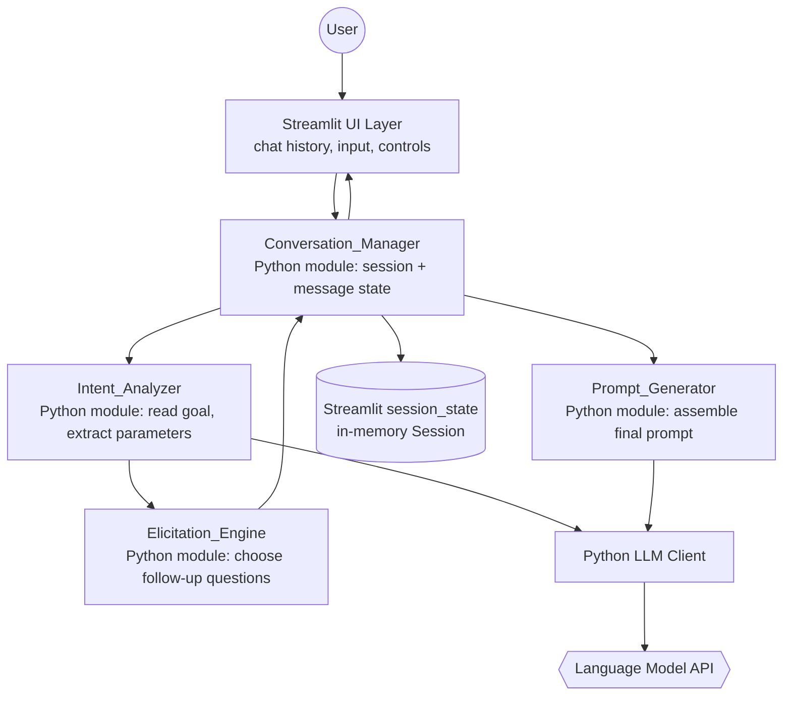
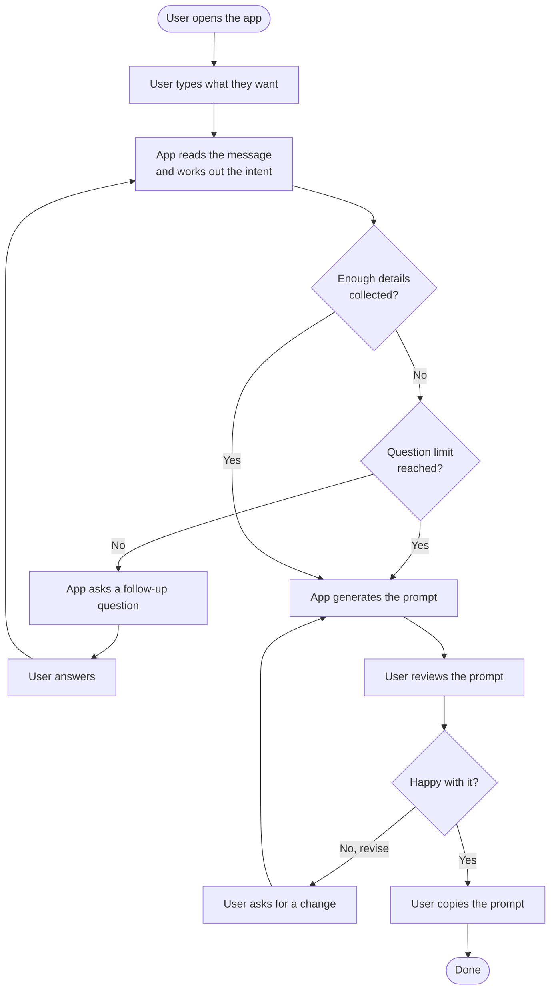

# Design Document

## Overview

The Conversational Prompt Builder is a small Streamlit web app written entirely in Python. The user talks to the app in plain language in a browser-based chat, the app asks a few focused follow-up questions, and then it writes a polished prompt based on everything the user shared.

The design is deliberately simple: one Streamlit script renders the chat UI, a thin set of Python logic modules does the deterministic work, and a single call-out to a language model (LLM) handles the "understanding" and "writing" parts. There is no database, no login, and no server-side storage. A conversation (a Session) lives entirely in Streamlit's in-memory session state while the user is interacting, and disappears when they start a new one or restart the app.

### Design Goals

- Keep the whole thing buildable and understandable by a solo developer.
- Keep the moving parts small: a Streamlit UI layer, a few plain Python logic modules, and one LLM client.
- Put all the testable rules (validation, parameter tracking, prompt assembly, message limits) in pure functions so they are easy to test and don't depend on the network or on a running Streamlit server.
- Use the LLM only for the fuzzy work (reading intent, phrasing questions, writing the final prompt). Everything deterministic stays in our own code.

### Key Design Decisions

| Decision | Choice | Why |
| --- | --- | --- |
| App shape | Streamlit web app, run locally with one command | No accounts, no persistence between visits required; Streamlit gives a browser-based chat UI in pure Python, which is the simplest thing that meets the requirements. |
| Language/stack | Python (3.11+) with Streamlit | Common and approachable, easy for one person to maintain. Streamlit is justified because the UI is a live, updating conversation view and Streamlit re-renders it on each interaction without any front-end code. |
| State | Streamlit's in-memory session state | Requirement 7 only needs persistence *within* an interaction, not across visits. Session state lasts for the duration of the interaction and resets when the app restarts. |
| LLM access | One small Python client module calling a hosted LLM API | The "intelligence" (intent, questions, prompt writing) is best handled by an LLM rather than hand-written rules. |
| Logic separation | Pure Python functions for all deterministic rules, kept out of the UI script | Makes behavior predictable and testable without a network and without starting Streamlit. |

A note on scope: the requirements mention that the first deliverable is a `README.md`. This design describes the application the README will point to; it does not change that ordering.

## Tools and Technologies

These are the tools the app is built with. They follow directly from the design choices above: a small, local Streamlit app that one person can build and maintain.

| Area | Choice | Why |
| --- | --- | --- |
| Language | Python (3.11+) | Readable and widely known, so the code is easy to follow and maintain. |
| UI framework | Streamlit | The screen is a live, updating conversation; Streamlit renders a browser-based chat UI from pure Python and runs with one command (`streamlit run`), so there is no separate front-end to build. |
| State | Streamlit `session_state` | A conversation only needs to last while the user is using it, so the in-memory session state is enough and nothing has to be saved. |
| LLM access | One Python client module that calls a hosted language model API | Keeps all the network details in one place; the specific provider is just a configuration choice (for example, an OpenAI-compatible API, using the official Python SDK or `httpx`/`requests`). |
| Testing | Hypothesis (property tests) with pytest (test runner) | Hypothesis checks the rules against many generated inputs, and pytest runs the tests. |
| Packaging / environment | A virtual environment (`venv`) with `requirements.txt` (or `pyproject.toml`), installed with `pip` | Standard, lightweight way to set up and run everything for a Python app. |

Note: there is no backend server beyond Streamlit itself, and no database. The app runs locally in the browser via Streamlit, and the only thing it reaches out to is the language model API.

## Architecture

The app has three layers:

1. **Streamlit UI layer** - the script Streamlit runs. It renders the chat history, the input box, the generated prompt, and the controls (new session, revise, copy, retry). It only displays state and forwards user actions to the logic layer.
2. **Core logic layer** - the four named components from the requirements (Conversation_Manager, Intent_Analyzer, Elicitation_Engine, Prompt_Generator) as plain Python modules/classes, plus the session state they operate on. Most of this is plain functions working on plain data.
3. **LLM client** - a single Python module that sends a request to the language model and returns its answer. The Intent_Analyzer and Prompt_Generator call it; nothing else does.



### Overall user flow

The diagram above shows the parts of the app and how they connect. The flowchart below shows the other side of the picture: the journey a user takes from opening the app to copying a finished prompt. The loop in the middle is the app asking follow-up questions until it has enough detail (or it reaches the 20-question limit).



### How a turn flows

Streamlit works by rerunning the whole script from top to bottom whenever the user interacts (submits input, clicks a button). State survives between reruns because it is kept in `session_state`. A turn looks like this:

1. The user types a message and submits it. Streamlit reruns the script.
2. The UI validates length (1-10,000 characters) and shows the in-progress indicator.
3. The Conversation_Manager records the message in the Session (held in `session_state`) and asks the Intent_Analyzer to interpret it, passing the retained conversation as context.
4. The Intent_Analyzer calls the LLM, gets back the goal (with a confidence level) and any extracted parameters, and updates the Prompt_Specification.
5. The Conversation_Manager computes which required parameters are still missing.
6. If parameters are missing (and the question limit isn't reached), the Elicitation_Engine produces the next follow-up question (1-3 parameters). Otherwise the Prompt_Generator produces the Generated_Prompt via the LLM.
7. The updated Session is written back to `session_state`, and the UI re-renders: the in-progress indicator is cleared and the new system message or prompt appears. On failure, it shows an error and a retry control.

### Why this structure

Keeping the LLM behind a single client module means the rest of the code never deals with network details, and the deterministic rules (what counts as missing, how messages are capped, how the prompt is assembled from collected values) can be tested in isolation. Keeping that logic in plain Python modules, separate from the Streamlit script, also means the rules can be tested without starting a Streamlit server. That is the main reason the component boundaries fall where they do.

## Components and Interfaces

Each component is small and has one job. Interfaces are shown as Python classes with type hints (using `@dataclass`, `typing`, and `Protocol`); the shapes matter more than the exact syntax.

### Conversation_Manager

Owns the Session: creates it, records messages, enforces the message cap, and sequences the other components.

```python
from typing import Protocol

class ConversationManager(Protocol):
    # Req 1.2, 1.3: create a session from the first message
    def start_session(self, first_message: str) -> "Session": ...

    # Req 3.3, 6.1, 7.1, 7.2: record a message, trimming to the 200 most recent
    def add_message(self, session: "Session", message: "Message") -> "Session": ...

    # Req 6.5, 7.5: begin a fresh, empty session
    def reset_session(self) -> "Session": ...

    # Req 5.2: record a revision request in the session
    def record_revision(self, session: "Session", revision_text: str) -> "Session": ...
```

### Intent_Analyzer

Reads a user message (in the context of the Session) and updates the Prompt_Specification. Uses the LLM for interpretation, but the merge/conflict rules are our own deterministic code.

```python
from dataclasses import dataclass
from typing import Optional, Protocol

class IntentAnalyzer(Protocol):
    # Req 2.1, 2.2, 7.3: interpret a message using session context
    def interpret(
        self, message: str, context: list["Message"], spec: "PromptSpecification"
    ) -> "InterpretationResult": ...

    # Req 2.2, 2.3: merge extracted parameters into the spec (last value wins, logs overwrites)
    def merge_parameters(
        self, spec: "PromptSpecification", extracted: list["ExtractedParameter"]
    ) -> "MergeResult": ...

    # Req 2.4: list required parameters that still have no value
    def missing_parameters(self, spec: "PromptSpecification") -> list["ParameterName"]: ...


@dataclass
class InterpretationResult:
    confidence: float                       # 0..1
    extracted: list["ExtractedParameter"]
    goal: Optional[str] = None              # unset if confidence below threshold (Req 2.5)
    context_unavailable: bool = False       # Req 7.4


@dataclass
class Overwrite:
    parameter: "ParameterName"
    previous: str
    next: str                               # Req 2.3


@dataclass
class MergeResult:
    spec: "PromptSpecification"
    overwrites: list[Overwrite]             # Req 2.3
```

The acceptance threshold is a single configured number (for example 0.6). If the LLM's confidence in the goal is below it, the goal stays unset and the Elicitation_Engine asks the user to describe the goal (Req 2.5).

### Elicitation_Engine

Decides what to ask next. Given the missing parameters and the per-parameter attempt counts, it picks 1-3 to ask about and phrases a question.

```python
from dataclasses import dataclass, field
from typing import Literal, Optional, Protocol, Union

class ElicitationEngine(Protocol):
    # Req 3.1, 3.2, 3.5: build the next question for 1-3 missing parameters, suggesting defaults
    def next_question(
        self, spec: "PromptSpecification", session: "Session"
    ) -> Optional["FollowUpQuestion"]: ...

    # Req 3.4, 3.6, 3.7: process an answer -> collected, declined, or retry
    def handle_answer(
        self, spec: "PromptSpecification", question: "FollowUpQuestion", answer: str
    ) -> "AnswerOutcome": ...

    # Req 3.8: whether the session has hit the 20-question limit
    def question_limit_reached(self, session: "Session") -> bool: ...


@dataclass
class FollowUpQuestion:
    parameters: list["ParameterName"]                       # 1..3
    text: str
    suggested_defaults: dict["ParameterName", str] = field(default_factory=dict)  # Req 3.5


@dataclass
class CollectedOutcome:
    spec: "PromptSpecification"                             # Req 3.4
    kind: Literal["collected"] = "collected"


@dataclass
class DeclinedOutcome:
    spec: "PromptSpecification"                             # Req 3.6
    kind: Literal["declined"] = "declined"


@dataclass
class RetryOutcome:
    attempts_left: int                                      # Req 3.7 (max 3 attempts)
    kind: Literal["retry"] = "retry"


AnswerOutcome = Union[CollectedOutcome, DeclinedOutcome, RetryOutcome]
```

Declined parameters are marked so the same question is not asked again in the Session (Req 3.6). A parameter that gets no usable answer is retried up to 3 times, then treated as unresolved (Req 3.7).

### Prompt_Generator

Turns the collected Prompt_Specification into the Generated_Prompt. The LLM does the writing; our code guarantees every collected parameter is included and reports any omitted required ones.

```python
from dataclasses import dataclass
from typing import Protocol

class PromptGenerator(Protocol):
    # Req 4.1, 4.2, 4.4: build the prompt; report required params left out
    def generate(self, spec: "PromptSpecification") -> "GenerationResult": ...

    # Req 5.2: produce a revised prompt from a revision request
    def revise(
        self, current: "GeneratedPrompt", revision_text: str, spec: "PromptSpecification"
    ) -> "GenerationResult": ...


@dataclass
class GenerationResult:
    prompt: "GeneratedPrompt"
    omitted_required: list["ParameterName"]  # Req 4.4 (empty when all collected)
```

### LLM Client

The only part that touches the network. It takes a structured request and returns text (or a structured object), and it surfaces failures as exceptions the callers can catch and turn into retryable error states (Req 4.5, 8.1-8.4).

```python
from typing import Protocol

class LlmClient(Protocol):
    def complete(self, request: "LlmRequest") -> "LlmResponse": ...  # raises on failure
```

### Streamlit UI Layer

A handful of UI pieces, all rendered by the Streamlit script using `session_state`:

- **Chat history rendering** - renders messages oldest-to-newest (for example with `st.chat_message`), visually distinguishing user vs system messages (Req 6.1, 6.2).
- **Message input** - the free-text input (for example `st.chat_input`) with length checks and inline error display (Req 1.1, 1.4, 1.5).
- **Prompt panel** - shows the Generated_Prompt with Revise and Copy controls (Req 5.1, 5.5).
- **Status / error display** - the in-progress indicator (for example `st.spinner`) and error banners with retry controls (Req 6.3, 6.4, 8.x).
- **New-session control** - a button that starts a fresh session (Req 6.5).

## Data Models

All models are plain Python data (`@dataclass`) held in Streamlit's `session_state`. No database schema is involved.

```python
from dataclasses import dataclass, field
from typing import Literal, Optional

# A named attribute of the prompt (audience, tone, format, length, domain, ...)
ParameterName = str


@dataclass
class ParameterDefinition:
    name: ParameterName
    required: bool
    default_value: Optional[str] = None       # Req 3.5


@dataclass
class ParameterValue:
    name: ParameterName
    value: str
    status: Literal["collected", "declined"]  # Req 3.4, 3.6
    attempts: int                             # Req 3.7 (0..3)


@dataclass
class Overwrite:
    parameter: ParameterName
    previous: str
    next: str


# The accumulated details for a session (Req 1.3, 2.2)
@dataclass
class PromptSpecification:
    goal_confidence: float                                        # 0..1
    goal: Optional[str] = None                                    # unset until confirmed (Req 2.5)
    parameters: dict[ParameterName, ParameterValue] = field(default_factory=dict)
    overwrite_log: list[Overwrite] = field(default_factory=list)  # Req 2.3


MessageSender = Literal["user", "system"]


@dataclass
class Message:
    id: str
    sender: MessageSender      # drives visual distinction (Req 6.2)
    text: str
    created_at: float          # ordering (Req 6.1, 7.1)


@dataclass
class GeneratedPrompt:
    text: str
    omitted_required: list[ParameterName]  # Req 4.4


# A single interaction, held in session_state only (Req 7)
@dataclass
class Session:
    id: str
    messages: list[Message] = field(default_factory=list)  # capped at 200, newest kept (Req 7.1, 7.2)
    spec: Optional[PromptSpecification] = None
    follow_up_count: int = 0                                # for the 20-question limit (Req 3.8)
    generated_prompt: Optional[GeneratedPrompt] = None
    context_available: bool = True                          # Req 7.4
```

### Model notes

- These models live in Streamlit's `session_state`, not in a database. They last for the duration of the interaction and are gone when the user starts a new session or the app restarts.
- The parameter catalog (which parameters exist, which are required, and their defaults) is a small static configuration the Intent_Analyzer and Elicitation_Engine both read. Keeping it as data rather than code makes it easy to adjust.
- "Missing" is derived, not stored: a required parameter is missing when it has no entry with status `collected`. Declined parameters are not missing (the user chose to skip them).
- Message capping keeps the newest 200 (Req 7.2); it is a pure function over the message list.

## Correctness Properties

*A property is a characteristic or behavior that should hold true across all valid executions of a system - essentially, a formal statement about what the system should do. Properties serve as the bridge between human-readable specifications and machine-verifiable correctness guarantees.*

These properties cover the deterministic logic (session management, parameter tracking, elicitation rules, prompt assembly, validation, message capping). The LLM calls themselves are not property-tested; where generation is involved, a mock LLM is used so the surrounding logic can be checked. Redundant criteria have been merged into comprehensive properties below.

### Property 1: New session starts clean and holds the first message

*For any* non-empty first message, creating a Session produces a Session that contains that message and whose Prompt_Specification has no goal and no collected parameters.

**Validates: Requirements 1.2, 1.3**

### Property 2: Message input validation

*For any* input string, submission is accepted if and only if the string contains at least one non-whitespace character and its length is between 1 and 10,000 characters; whitespace-only strings are rejected as empty, and strings longer than 10,000 characters are rejected for length.

**Validates: Requirements 1.4, 1.5**

### Property 3: Extracted parameters are merged into the specification

*For any* list of extracted parameters that map to defined Parameters, after merging, every such parameter has its value stored in the Prompt_Specification.

**Validates: Requirements 2.2**

### Property 4: Conflicts keep the most recent value and are logged

*For any* parameter that already has a value and a newly extracted different value, after merging the stored value equals the new value and the overwrite log records the previous value.

**Validates: Requirements 2.3**

### Property 5: Missing set is exactly the uncollected required parameters

*For any* Prompt_Specification, the computed set of missing Parameters equals exactly the required Parameters that have no value with status "collected".

**Validates: Requirements 2.4**

### Property 6: Low confidence leaves the goal unset and asks for it

*For any* interpretation result whose confidence is below the acceptance threshold, the Prompt_Specification goal remains unset and a follow-up question asking the user to describe the goal is produced.

**Validates: Requirements 2.5**

### Property 7: Follow-up questions request 1 to 3 missing parameters

*For any* Prompt_Specification with at least one missing required Parameter and under the session question limit, the next follow-up question is non-null and references between 1 and 3 Parameters, all of which are currently missing.

**Validates: Requirements 3.1, 3.2**

### Property 8: Usable answers mark parameters collected

*For any* follow-up question and a usable answer for a requested Parameter, handling the answer marks that Parameter as "collected" with the provided value.

**Validates: Requirements 3.4**

### Property 9: Defaults are offered as suggestions

*For any* follow-up question, every requested Parameter that has a default value appears in the question's suggested defaults.

**Validates: Requirements 3.5**

### Property 10: Skipped parameters are declined and never re-asked

*For any* follow-up question answered with an empty or skip response, the requested Parameter becomes "declined" and no subsequent follow-up question in the same Session requests it again.

**Validates: Requirements 3.6**

### Property 11: Unusable answers retry up to three attempts

*For any* Parameter, repeatedly providing unusable (non-skip) answers increases its attempt count up to a maximum of 3; after the third attempt the Parameter is no longer re-presented in the Session.

**Validates: Requirements 3.7**

### Property 12: Follow-up questions stop at twenty

*For any* Session, the question limit is reached if and only if the follow-up count is 20 or more, and at the limit the next follow-up question is null.

**Validates: Requirements 3.8**

### Property 13: Generated prompt includes all collected parameters and reports omissions

*For any* Prompt_Specification, the generated prompt includes the value of every collected Parameter, and the reported list of omitted required Parameters equals exactly the required Parameters that are not collected (empty when all required Parameters are collected).

**Validates: Requirements 4.1, 4.2, 4.4**

### Property 14: Revision request validation

*For any* revision request string, the request is accepted if and only if it is non-empty and at most 2000 characters; otherwise it is rejected and the current Generated_Prompt is unchanged.

**Validates: Requirements 5.3**

### Property 15: Conversation renders oldest to newest

*For any* list of messages in a Session, the conversation view renders them ordered by submission time from oldest to newest.

**Validates: Requirements 6.1**

### Property 16: Sender determines the visual treatment

*For any* message, the visual treatment applied is determined solely by whether the sender is the user or the System, and the treatment for user messages differs from that for System messages.

**Validates: Requirements 6.2**

### Property 17: Starting a new session clears everything

*For any* existing Session state, starting a new Session yields a Session with no messages and an empty Prompt_Specification.

**Validates: Requirements 6.5, 7.5**

### Property 18: Messages are retained in order and capped at 200

*For any* sequence of messages added to a Session, the Session retains them in submission order, and when the count would exceed 200 it keeps exactly the 200 most recent, discarding the oldest.

**Validates: Requirements 3.3, 7.1, 7.2**

### Property 19: Retries stop after three consecutive failures

*For any* operation that keeps failing, the retry controller stops after 3 consecutive failed attempts, reports that the operation could not be completed, and leaves the Session content unchanged.

**Validates: Requirements 8.4**

## Error Handling

Errors fall into a few simple categories, each handled the same way wherever it occurs.

**Input errors (handled in the UI, before any work starts).**
- Empty/whitespace message, message over 10,000 characters, empty revision, revision over 2000 characters: the UI rejects the submission, keeps the user's typed text, and shows an inline error naming the rule. No LLM call is made (Req 1.4, 1.5, 5.3).

**LLM/operation failures (interpretation, generation, revision).**
- The LLM client raises on failure. The calling component catches it, leaves the Session content and Prompt_Specification unchanged, and returns a retryable error state.
- On the next rerun the UI removes the in-progress indicator, keeps the submitted user message in the history, shows an error message, and offers a Retry control (Req 4.5, 5.4, 6.4, 8.1, 8.2).
- Retry re-runs the same operation. After 3 consecutive failures, the UI shows a "could not be completed" message and stops retrying, with Session content still intact (Req 8.3, 8.4). This retry/cap logic is a plain controller (see Property 19).

**Clipboard failures.**
- Copying is done through a Streamlit mechanism, for example the built-in copy button on `st.code`, or a small copy component. If copying fails, the UI shows a copy-failed error; success shows a short confirmation (Req 5.6, 5.7).

**Context unavailable.**
- If the retained Session content cannot be read when interpreting, the Intent_Analyzer interprets the current message on its own and the UI shows a "prior context unavailable" note (Req 7.4).

**Early generation.**
- Generating before all required Parameters are collected is not an error: the prompt is produced from what is collected and the omitted required Parameters are listed for the user (Req 4.4).

## Testing Strategy

The deterministic logic is well suited to property-based testing, so the strategy uses two complementary layers.

### Property-based tests

Property-based testing fits here because the core modules are pure functions over structured data (specifications, parameter lists, message lists, validation inputs), with clear "for all inputs" rules.

- Library: use an established property-based testing library for the chosen stack - **Hypothesis** for Python, with **pytest** as the test runner. Do not hand-roll property testing.
- Each of the 19 correctness properties above is implemented by a **single** property-based test.
- Each property test runs a **minimum of 100 iterations** (Hypothesis `max_examples >= 100`).
- Each property test is tagged with a comment in this format:
  `# Feature: conversational-prompt-builder, Property {number}: {property text}`
- LLM calls are replaced with a mock LLM client in these tests. For assembly tests (Property 13), the mock echoes the structured content so the test can assert every collected parameter is present. This keeps the tests fast, deterministic, and offline.
- Generators cover edge cases directly: whitespace-only and boundary-length strings (Properties 2, 14), specifications with mixtures of collected/declined/missing parameters (Properties 5, 7, 13), and message sequences both under and over 200 (Property 18).

### Unit tests (examples and error paths)

Example-based unit tests cover the specific scenarios and error paths that are not input-varying. Because the core logic lives in plain Python modules kept out of the Streamlit script, these tests call the logic functions directly, with no running Streamlit server. For the lightweight UI checks that do need the script, Streamlit's `AppTest` can drive the app in-process where helpful.

- UI presence checks: input field on open (1.1), revise and copy controls when a prompt is shown (5.1, 5.5).
- Error paths with a mock LLM that raises: generation failure retains parameters and offers retry (4.5), revision failure keeps the previous prompt (5.4), processing failure keeps the message and shows an error (6.4), response/prompt failure handling (8.1, 8.2).
- Clipboard success confirmation and failure error (5.6, 5.7).
- Degraded context: interpretation proceeds in isolation with an indication shown (7.4).
- Wiring check: the analyzer receives retained session messages as context (7.3).

### Integration tests (timing and external behavior)

A small number of integration tests cover timing and the real LLM/clipboard boundaries, with 1-3 representative examples each (not repeated 100 times):

- Interpretation completes within its budget (2.1).
- Generated prompt renders promptly after production (4.3).
- Revision completes within its budget (5.2).
- In-progress indicator appears quickly and clears on resolution (6.3).
- Retry re-executes and resolves within budget (8.3).
- New-session view clears within its budget (7.5 timing aspect).

### Balance

The property tests carry the weight of verifying general correctness, so unit tests stay focused on concrete examples, integration points, and error conditions rather than trying to cover many inputs by hand.
